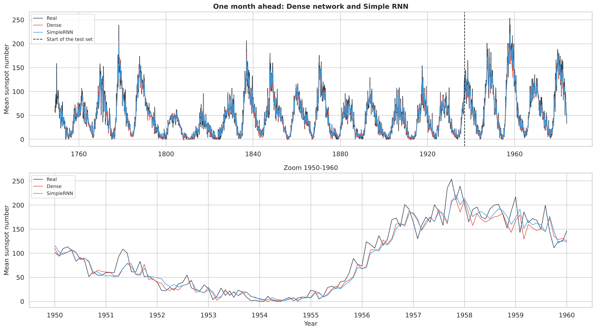
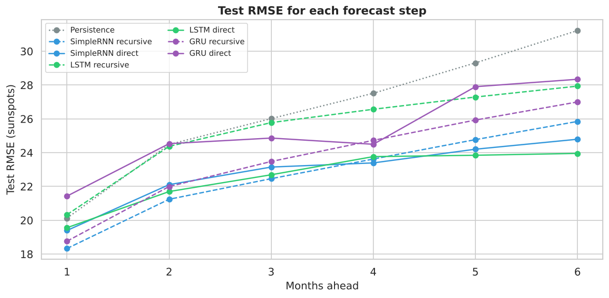
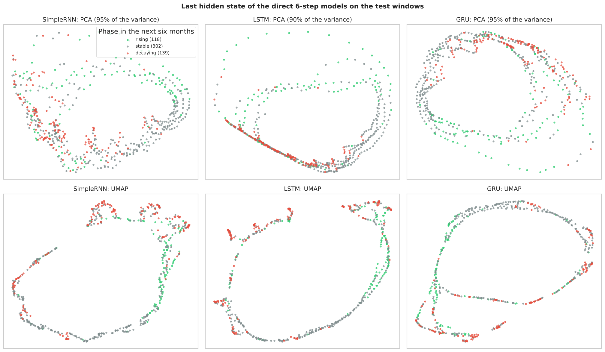

# Sunspots Forecasting with Dense, Simple RNN, LSTM and GRU Networks

Forecasting the **monthly mean total sunspot number** (1749-1983) one month and six months ahead with PyTorch, comparing a Dense network with three recurrent architectures: Simple RNN, LSTM and GRU.

Midterm project of the course *Advanced Machine Learning and Deep Learning* (BSc in Data Science and Artificial Intelligence, SUPSI), November 2026.



## Highlights

- **No data leakage.** The split is fixed in time (70% training, 10% validation, 20% test), the scaler is fitted on the training months only, and each window is assigned to the period that contains all its targets.
- **Same selection for every model.** All models are tuned on the same grid (window length, hidden size, value or change as output, dropout). The window length is checked with a chronological validation on three periods, and each final model is trained with three seeds.
- **Multi-step forecasting.** The recursive and direct approaches are compared six months ahead, with the error analysed in each phase of the solar cycle (rising, stable, decaying).
- **Interpretation.** The last hidden states of the recurrent models are projected with PCA and UMAP.
- **Fast to reproduce.** The 209 trained models are cached in `saved_models/`, so the whole notebook runs in about one minute. Without the cache every model is trained from scratch (about 70 minutes on a CPU).

## Results

Test set: 1937-1983, 564 months. RMSE in sunspots; the ± values are mean ± standard deviation over three seeds.

**One month ahead**

| Model | Test RMSE | vs persistence | 3 seeds | Parameters |
| :--- | :---: | :---: | :---: | :---: |
| Persistence (last month) | 20.09 | - | - | 0 |
| Dense | **18.23** | -9% | 18.36 ± 0.24 | 2 081 |
| Simple RNN | 18.29 | -9% | 18.51 ± 0.21 | 4 353 |
| LSTM | 20.30 | +1% | 19.52 ± 0.70 | 4 513 |
| GRU | 18.74 | -7% | 18.67 ± 0.10 | 12 929 |

**Six months ahead**

| Method | RMSE, 6 steps | RMSE, step 6 | Step 6, 3 seeds |
| :--- | :---: | :---: | :---: |
| Persistence | 26.69 | 31.23 | - |
| Dense, recursive | 22.59 | 25.24 | 25.83 ± 2.38 |
| Dense, direct | **22.52** | 25.08 | 27.17 ± 1.81 |
| Simple RNN, recursive | 22.85 | 25.85 | 26.91 ± 0.96 |
| Simple RNN, direct | 22.91 | 24.79 | 25.05 ± 0.26 |
| LSTM, direct | 22.64 | **23.96** | **24.81 ± 0.83** |
| GRU, recursive | 23.81 | 27.00 | 26.41 ± 0.59 |



## Key findings

- **One month ahead,** a small Dense network is as good as any recurrent network. The difference between Dense and Simple RNN is smaller than the effect of the seed, and the predictions stay close to the last month: the last value carries most of the information.
- **Six months ahead,** the gain over persistence grows from about 9% to 15%. The recursive approach wins at the first step but accumulates errors; the direct approach is better at the later steps. The direct Simple RNN is the most stable method (22.92 ± 0.08 over the six steps).
- **LSTM and GRU** are the only models that profit from longer windows. The direct LSTM gives the lowest error at the sixth step and corrects the rising phases best (mean error -26.8 against -42.3 for persistence), at about four times the parameters of the Simple RNN.
- **All the networks** anticipate decays of the cycle much better than rises, and all of them stay below the highest peaks of the test set.
- **Hidden states.** The states of the three recurrent cells mainly encode the level of the series, arranged as a ring that follows the solar cycle; none of them separates the phases clearly.
- **Tested and not adopted:** a square-root transform before scaling. It makes the data almost Gaussian, but brings no gain on the validation set.



## Methods

| Step | Choice |
| :--- | :--- |
| Data | [Monthly sunspots dataset](https://raw.githubusercontent.com/jbrownlee/Datasets/master/monthly-sunspots.csv): 2820 months, no gaps; outliers checked and kept (real solar maxima) |
| EDA | statistics, lag plot, seasonality check, boxplot outliers, autocorrelation up to 300 months (solar cycle of about 11 years) |
| Inputs | sliding windows of 24, 48, 63 or 125 months, scaled to [0, 1] with `MinMaxScaler` |
| Models | Dense (one hidden layer), Simple RNN, LSTM, GRU; the head reads the last hidden state; optional residual output (last month + predicted change) and dropout |
| Training | MSE loss, Adam (lr 0.001), mini-batches of 64, gradient clipping (norm 1), early stopping (patience 20) with the best weights restored |
| Selection | validation RMSE on a grid, chronological validation on three periods, three seeds for the final models |
| Evaluation | RMSE (main), MAE, RMSE for each forecast step, error by level and by phase of the cycle, against persistence and mean baselines |

## Repository structure

```
.
├── sunspots_midterm_project.ipynb   # the whole project, with all outputs
├── saved_models/                    # cached weights: <model>/<horizon>-step/<settings>_<fingerprint>.pt
├── images/                          # figures used in this README
├── requirements.txt
└── README.md
```

## How to run

```bash
git clone https://github.com/mattialoi/MidTerm_proj.git
cd MidTerm_proj
pip install -r requirements.txt
jupyter notebook sunspots_midterm_project.ipynb
```

The dataset is downloaded automatically. Trained models are loaded from `saved_models/`. Set `FORCE_RETRAIN = True` in the configuration cell to train everything again; the fixed seed (67) makes the runs reproducible.

Tested with Python 3.13, PyTorch 2.15, scikit-learn 1.9 and umap-learn 0.5.

## Author

**Mattia Loi**, BSc student in Data Science and Artificial Intelligence at SUPSI. [github.com/mattialoi](https://github.com/mattialoi)
